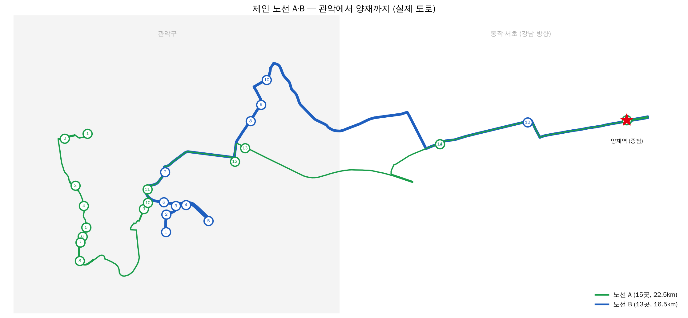

# 서울버스 수요분석

KT AI+X 2차 프로젝트 (5조). 2022년 4월 서울 버스 승하차, 유동인구 데이터로 "어느 구에 버스 시설의 추가가 가장 필요한가"에 답했다.

## 결론

관악구. 버스가 부족한 게 아니라 가는 방향이 한쪽으로 몰려 있다.

- 관악 정류장 107곳 중 86곳(80.4%)은 걸어서 300m 안에 강남 가는 노선이 0개 (25개 구 중 1위, 중앙값 5.2%)
- 그래서 증편이 아니라 관악에서 양재역으로 가는 평일 아침 출근 노선 2개를 제안
  - 노선 A: 난곡, 신림 쪽 15곳 정차, 22.5km
  - 노선 B: 서울대, 봉천 쪽 13곳 정차, 16.5km
  - 강남 공백 정류장 승차의 39.2%, 단일노선 의존 정류장 승차의 13.3%를 태움



## 흐름

1. 상명대정문: 한 달 61,599명이 타는데 멀리 가는 버스는 7016 하나
2. 이런 단일노선 의존 정류장이 서울에 155곳
3. 버스를 늘리면 되나?
4. 걸어서 닿는 버스 수가 비슷한 정류장끼리 비교해도, 의존 정류장은 출근 1위 목적지로 가는 버스가 없는 경우가 더 많음 (p<0.01)
5. 수가 아니라 방향의 문제
6. 의존 비율 1위, 강남 공백 1위 = 관악구
7. 관악에서 양재역까지 새 노선 A, B

## 가설

| 가설 | 방법 | 결과 |
|---|---|---|
| H1 몰림: 의존 정류장은 같은 노선 안에서 더 많이 탄다 | 순위합 검정(W) | 성립, 0.917 vs 0.590 (p<0.05) |
| H2 버팀: 의존 정류장은 마을버스로 버틴다 | 순위합 검정(W), 층별 | 성립, 마을버스 승차 15,988 vs 5,033 (3.18배, p<0.05) |
| H3 방향 공백: 의존 정류장은 출근 1위 목적지행 노선이 없다 | 카이제곱, 층별 MH | 성립, 서울 전체 약 2.75배 (p<0.01), 관악 빼도 성립 |

역 거리 200m, 500m, 도보권 기준으로 바꿔도 결과가 유지되는지 확인했다.

## 노선 정한 과정

| 단계 | 방법 | 고친 점 |
|---|---|---|
| 1차안 | 강남 공백 정류장 86곳을 KMeans(k=2)로 나누고 많이 타는 곳을 직선으로 연결 | 별 모양, 정차 없이 11.5km 가는 구간 |
| 2차안 | 기존 노선 506, 5517의 정류장 순서를 길 대신 사용 | 의존 정류장에 한 곳도 안 섬 |
| 3차안 | 의존 정류장이면서 강남 공백인 2곳 추가 | 길이는 아직 직선 기준 |
| 최종 | OSRM(OpenStreetMap)으로 실제 도로 거리 계산, 지나가던 정류장 정차 추가 | 39.0km, 승차 약 24만 명/월 증가 |

직선으로 재면 실제 도로보다 1.4~1.6배 짧게 나왔다 (난곡종점 → 난향동주민센터 직선 350m, 도로 1,030m).

## 폴더

```
ppt/        최종 발표 PPT
route_map/  노선도
```

## 데이터

원본 데이터는 용량 때문에 올리지 않았다.

- 교수님 실습 자료: 버스 노선, 정류장별 승하차 (2022.4), 구별 이동 유동인구, 주민등록 인구
- 서울 열린데이터광장: OA-15067 버스정류소 위치정보, OA-21232 역사마스터, OA-1095 노선별 정류소
- 도로: OpenStreetMap (ODbL), OSRM 자동차 경로

개인 단위 개인정보 컬럼(성별, 나이 등)은 읽지 않았다.

## 한계

- 2022년 4월 한 달 데이터 (신림선 개통 전)
- 소요 시간은 재지 않음. "더 빠르다"가 아니라 "갈아타는 횟수가 줄어든다"까지만 말할 수 있음
- 역 좌표 일부는 대략 찍은 값
- 인과가 아니라 비교
